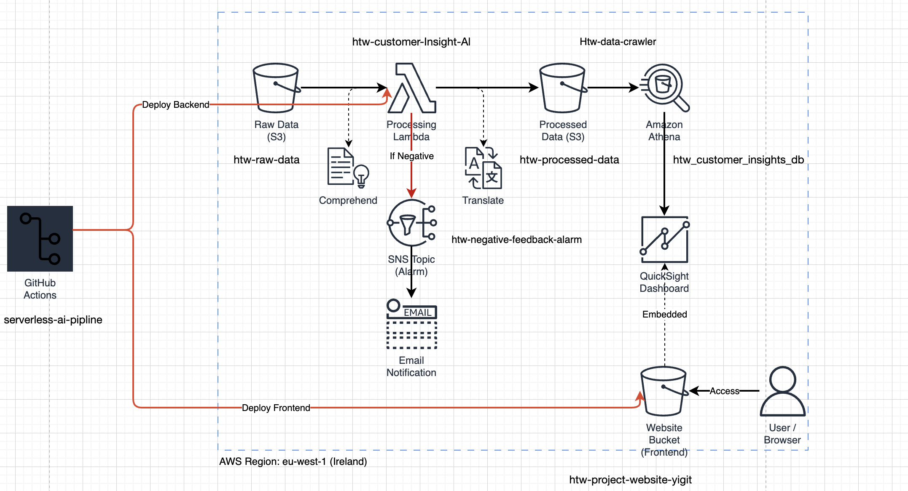

# Serverless AI Pipeline on AWS

An event-driven, serverless pipeline that analyzes customer reviews with AI: it detects language and sentiment, raises an email alert for negative feedback, and makes the results queryable and visible on a dashboard.

Built as a project for the **Cloud Computing** course of the M.Sc. Professional IT Business & Digitalization at **HTW Berlin** (Winter Semester 2025/26).

## Architecture

All resources run in the AWS region **eu-west-1 (Ireland)**.

## How it works

| Stage | What happens |
|---|---|
| 1. CI/CD | GitHub Actions automatically deploys the backend code to the Lambda function and the frontend code to the website S3 bucket. |
| 2. Ingestion | A text file containing a customer review is uploaded to the raw-data S3 bucket. |
| 3. Trigger | The upload event automatically invokes the Lambda function. |
| 4. AI analysis | Lambda calls Amazon Comprehend to detect the language and sentiment of the text (the architecture also includes Amazon Translate). |
| 5. Alerting | If the sentiment is NEGATIVE, Lambda publishes to an Amazon SNS topic, which sends an email notification to the administrator. |
| 6. Storage | Lambda saves the result (sentiment, confidence score, language) as a JSON file in the processed-data S3 bucket. |
| 7. Analytics | An AWS Glue crawler scans the processed bucket and updates the schema, so the data can be queried with SQL in Amazon Athena. |
| 8.  Visualization | An Amazon QuickSight dashboard is embedded in a static website hosted on S3. |

The Lambda function runs under a dedicated IAM role that gives it access to S3 and the AI services.

## AWS services used

| Service | Role in the project |
|---|---|
| Amazon S3 | Raw data, processed data and static website hosting |
| AWS Lambda | Event-driven processing logic |
| Amazon Comprehend | Language and sentiment detection |
| Amazon Translate | Text translation |
| Amazon SNS | Email alerts for negative feedback |
| AWS Glue | Crawler that maintains the data schema |
| Amazon Athena | SQL queries on the processed data |
| Amazon QuickSight | Dashboard, embedded in the website |
| AWS IAM | Execution role for the Lambda function |
| GitHub Actions | Automated deployment (CI/CD) |

## Author

Yigit Peker, HTW Berlin
